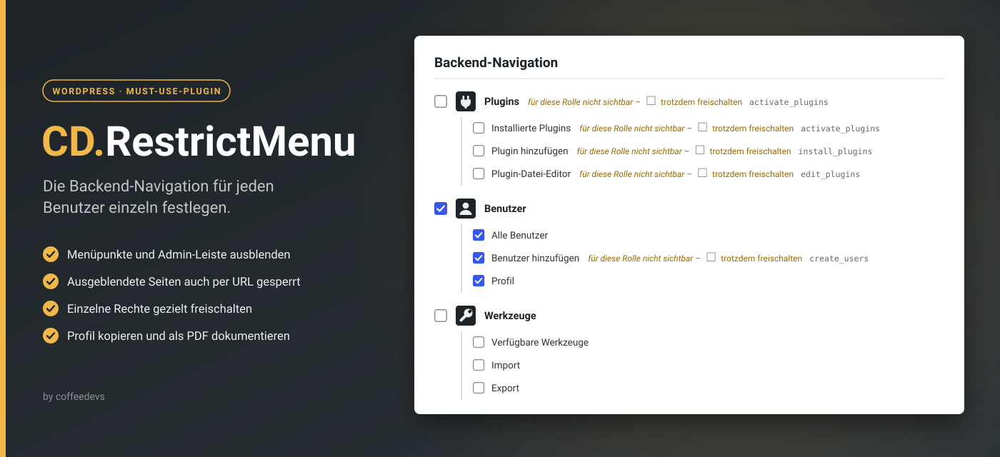

# CD.RestrictMenu



WordPress-Must-Use-Plugin. Ermöglicht es einem festgelegten Superuser, die Backend-Navigation anzupassen, sodass Sie die beste Benutzererfahrung in der Bedienung erhalten und nicht durch unnütze Inhalte gestört werden.

Der Superuser wird im Plugincode festgelegt. Nur er kann für jeden anderen Benutzer einzeln bestimmen, welche Einträge der Backend-Navigation und der Admin-Leiste sichtbar sind. Für den Superuser selbst gelten keine Einschränkungen.

## Funktionen
- **Link in der Benutzerliste:** Unter *Benutzer* erscheint beim Überfahren eines Benutzernamens der Link **Menü-Sichtbarkeit** (goldfarben). Nur der Superuser sieht ihn, und nicht bei sich selbst.
- **Zugriffsschutz:** Die Einstellungsseite wird nur für den Superuser registriert. Beim Öffnen und bei jedem Speichern wird erneut geprüft, ob der Aufrufer der Superuser ist (zusätzlich Nonce).
- **Baum der Backend-Navigation:** gleiche Reihenfolge wie im WordPress-Menü, mit Haupt- und Unterpunkten, Icons und je einer Checkbox. Haken = sichtbar. Ein neuer Benutzer hat alle Haken; beim Öffnen wird der gespeicherte Stand eingelesen.
- **Admin-Leiste:** zweiter Baum für die obere Leiste (Toolbar) mit eigenen Checkboxen.
- **Sperre per Direktaufruf:** Ausgeblendete Seiten sind nicht nur unsichtbar, sondern auch über die URL gesperrt (Meldung „Kein Zugriff“). Ist das Dashboard ausgeblendet, wird auf die erste sichtbare Seite weitergeleitet.
- **Trotzdem freischalten:** Einträge, die die Rolle eines Benutzers nicht sehen darf, sind markiert und lassen sich über einen zusätzlichen Haken erlauben. Der Benutzer erhält dafür die dahinter genannte Berechtigung.
- **Copy2User:** überträgt das gespeicherte Rechteprofil auf einen anderen Benutzer derselben Benutzergruppe (ohne Superuser).
- **Drucken / PDF:** druckt beide Kästen in voller Länge zu Dokumentationszwecken; im Druckdialog „Als PDF speichern“ wählen. Die Kastenüberschrift wird auf jeder Seite wiederholt, Gruppen werden nicht mitten im Text getrennt.

## Installation

### Besonderheiten eines Must-Use-Plugins
Ein Must-Use-Plugin („mu-plugin“) unterscheidet sich von einem normalen Plugin:
- Es liegt im Ordner `wp-content/mu-plugins/`, nicht in `wp-content/plugins/`.
- Es ist **immer aktiv**. Es gibt keinen Aktivieren-/Deaktivieren-Link; im Backend lässt es sich weder abschalten noch löschen. Genau deshalb eignet es sich für diese Aufgabe: Ein eingeschränkter Benutzer kann es nicht einfach deaktivieren.
- Es lässt sich **nicht über das Backend installieren** (kein ZIP-Upload), sondern nur per FTP/SFTP oder über den Dateimanager des Hosters.
- WordPress lädt nur PHP-Dateien, die **direkt** im Ordner `mu-plugins` liegen. Dateien in Unterordnern werden nicht geladen.
- Es wird **vor** allen normalen Plugins geladen.
- Es gibt **keine Update-Hinweise und keine automatischen Updates**. Ein Update bedeutet: Datei ersetzen.
- Aktivierungs- und Deinstallationsroutinen gibt es nicht.
- In einer Multisite gilt es für alle Websites des Netzwerks.
- Sichtbar ist es unter *Plugins* im Reiter **Must-Use** (dort nur zur Information).

### Schritte
1. **Superuser eintragen:** In `menu-sichtbarkeit.php` oben den Benutzernamen (Login) eintragen:
   ```php
   define( 'CDMV_SUPERUSER', 'benutzername' );
   ```
   Alternativ dieselbe Zeile in die `wp-config.php` schreiben (oberhalb von „That's all, stop editing“); dann bleibt die Plugin-Datei unverändert.
2. **Ordner prüfen:** Per FTP/SFTP oder Dateimanager nach `wp-content/` wechseln. Fehlt der Ordner `mu-plugins`, ihn anlegen.
3. **Datei hochladen:** `menu-sichtbarkeit.php` direkt nach `wp-content/mu-plugins/` kopieren (nicht in einen Unterordner). `README.md`, `MEMORY.md` und der Ordner `assets` gehören nicht auf den Server.
4. **Prüfen:** Im Backend unter *Plugins → Must-Use* muss **CD.RestrictMenu** stehen. Als Superuser unter *Benutzer* einen Namen überfahren – der Link **Menü-Sichtbarkeit** erscheint.

### Update
Datei `menu-sichtbarkeit.php` auf dem Server durch die neue Fassung ersetzen. Gespeicherte Einstellungen bleiben erhalten. Wurde der Superuser in der Plugin-Datei eingetragen (nicht in der `wp-config.php`), ihn in der neuen Datei erneut eintragen.

### Entfernen
Datei aus `wp-content/mu-plugins/` löschen. Alle Einschränkungen und Freischaltungen sind damit sofort aufgehoben. In der Datenbank bleiben zurück und können bei Bedarf gelöscht werden: der Benutzer-Meta-Schlüssel `cdmv_hidden` und die Option `cdmv_bar_nodes`.

### Voraussetzungen
WordPress, PHP ≥ 7.4. Der Superuser sollte Administrator sein, damit der Baum das vollständige Menü zeigt.

## Hinweise
- **Speichern vor Copy2User:** Übertragen wird der zuletzt gespeicherte Stand. Das Profil des Empfängers wird vollständig überschrieben.
- **Freischalten gilt umfassend:** Eine freigeschaltete Berechtigung gilt überall, wo WordPress oder ein Plugin sie abfragt, nicht nur für den einen Menüpunkt. Bei `manage_options` sind das weitreichende Admin-Rechte. Bei Inhaltstypen und Taxonomien kommen deren Bearbeitungsrechte dazu.
- **Frontend-Einträge der Admin-Leiste** (z. B. „Seite bearbeiten“) erscheinen im Baum erst, nachdem der Superuser die Website einmal angemeldet im Frontend besucht hat.
- **Bearbeiten-Ansichten** (bestehenden Beitrag oder Seite öffnen) werden nur gesperrt, wenn der ganze Bereich ausgeblendet ist.
- **Neue Plugins:** Später hinzukommende Menüpunkte sind zunächst für alle sichtbar, bis sie abgewählt werden.
- **Aussperren:** Der Superuser kann sich nicht selbst einschränken. Ist der eingetragene Benutzername falsch, gibt es keinen Superuser und der Link erscheint bei niemandem – bestehende Einschränkungen gelten dann weiter.

## Struktur
```
menu-sichtbarkeit.php   das gesamte Plugin (eine Datei, inkl. CSS und JS)
assets/banner.svg       Banner für diese README (nicht Teil des Plugins)
README.md               diese Datei
MEMORY.md               Projektkontext und Entscheidungen
```
